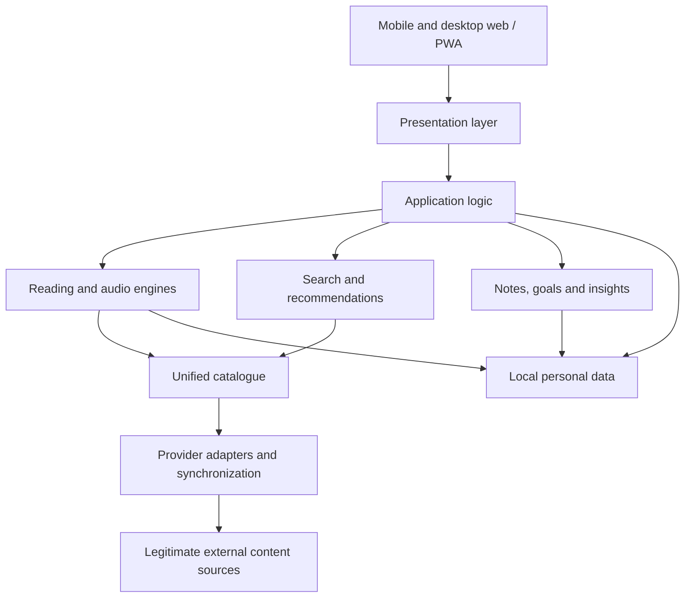

# Folio

**Your personal reading companion. Discover, read, listen, and learn — for free.**

Folio is a mobile-first digital reading platform designed to make literature and knowledge more accessible. It brings legally free books, novels, and audiobooks into a unified library, with a customizable reading experience and tools for building meaningful reading habits.

The goal is simple: make reading a natural part of everyday life, without subscriptions, advertisements, or unnecessary distractions.

## Product vision

Folio combines the discovery experience of a digital library with the comfort of an e-reader and the convenience of an audiobook player. Its design prioritizes calm typography, intuitive navigation, personal preferences, and accessibility across mobile and desktop devices.

## Features

The following describes the product's intended feature set. Individual features and integrations should be verified against the current implementation.

| Area | Capabilities |
| --- | --- |
| **Discover** | Browse books and novels by genre, author, and publication year; search across supported sources; explore contemporary literature and newly available titles. |
| **Read** | Distraction-free reading, chapter navigation, bookmarks, saved progress, adjustable typography, and light, dark, and sepia reader themes. |
| **Listen** | Free audiobook discovery, text-to-speech for eligible content, playback speed controls, sleep timer, and saved listening progress where supported. |
| **Personalize** | Reading presets, favourite genres, personalized recommendations, mood-based discovery, and daily selections. |
| **Learn** | Dictionary lookup, passage highlights, personal notes, and a reading notebook. |
| **Build habits** | Reading and listening goals, optional reminders, activity history, and personal reading insights. |
| **Read offline** | Save eligible books for offline access, with local persistence and download management where supported. |
| **Own your data** | Local-first reading data, portable backups, and restore functionality without mandatory accounts. |

## Content and availability

Folio is designed to aggregate public-domain and openly licensed literature, as well as books explicitly made available for free by their rights holders. Its catalogue aims to include both classics and contemporary works, including titles published from 2000 onward.

Potential content sources include:

- [Project Gutenberg](https://www.gutenberg.org/) — public-domain ebooks.
- [Gutendex](https://gutendex.com/) — Project Gutenberg catalogue metadata.
- [Standard Ebooks](https://standardebooks.org/) — carefully formatted public-domain ebooks.
- [Wikisource](https://wikisource.org/) — freely accessible source texts.
- [LibriVox](https://librivox.org/) — volunteer-narrated public-domain audiobooks.
- Open-access publishers and official author websites offering legitimate free editions.

The catalogue is intended to refresh periodically, normalize metadata, deduplicate records, and preserve existing reading progress. The refresh mechanism may use scheduled synchronization or automatic refresh on launch, depending on the deployment environment.

Folio does not aim to bypass paywalls or distribute unauthorized copies. Availability, copyright status, and offline or narration permissions depend on the specific work, provider, and reader's jurisdiction. Not every published book is legally available for free.

## High-level architecture

Folio follows a modular, mobile-first, local-first design. The diagram describes the intended architecture rather than a verified repository layout.



### Intended technology stack

| Layer | Preferred technology |
| --- | --- |
| Frontend | React and TypeScript |
| UI | Responsive, reusable editorial design system |
| Server-side integration | Lightweight Node.js runtime, where needed |
| Personal data | IndexedDB or equivalent browser storage |
| Ebook rendering | EPUB.js or equivalent, sanitized HTML |
| Audio | HTML audio and browser-native Web Speech API |
| Offline support | Service workers and Cache API |
| Recommendations | Lightweight metadata-based algorithms |
| Hosting | Free-tier infrastructure, subject to provider limits |

The core reading experience is intended to work without paid AI inference. Technology choices may differ in the actual implementation.

## Getting started

For a generated React/Node project using npm, the usual local setup is:

```bash
npm install
npm run dev
```

Open the local URL printed by the development server.

Use the scripts declared in the project's `package.json` for builds, linting, type checking, and tests. If content-provider configuration is required, follow the repository's environment setup and keep credentials out of client-side code and version control.

These setup commands are a suggested starting point; the actual repository and scripts have not been inspected for this README.

## Engineering philosophy

Folio is guided by Engineering Core, a Karpathy-inspired approach to AI-assisted software engineering:

- **Think before implementing:** understand the objective and surface important assumptions.
- **Keep it simple:** prefer the smallest correct, maintainable solution.
- **Make focused changes:** preserve working functionality and avoid unrelated refactoring.
- **Define success:** use observable acceptance criteria and appropriate context.
- **Verify and refine:** test real behavior, inspect results, and correct failures.
- **Keep humans in control:** preserve approval boundaries and report limitations honestly.

## Privacy, accessibility, and cost

Folio prioritizes local storage for personal reading data, accessible controls, readable typography, responsive layouts, and minimal infrastructure. Its target operating cost is ₹0, subject to hosting and content-provider limits. Browser storage, background audio, offline availability, and notifications vary by device and platform.

## Roadmap

- Broaden legitimate contemporary book and audiobook discovery.
- Improve catalogue reliability and automatic synchronization.
- Refine mobile reading, listening, and offline experiences.
- Strengthen annotation persistence, personal recommendations, and data portability.
- Evaluate optional cross-device synchronization only when it adds genuine value.

## License

The project's software license has not been specified. Third-party books, cover images, audio recordings, and libraries retain their respective licenses and rights.

---

**Folio — A little reading, every day.**
